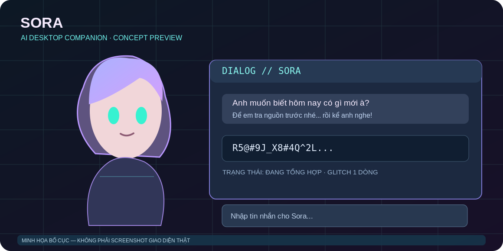

# SORA · AI Desktop Companion

> **Sora** là nhân vật đồng hành AI trên Windows: giao diện Electron/RT, bộ não Ollama cục bộ, bộ nhớ SQLite và các công cụ tương tác desktop. Dự án mang phong cách cyberpunk, nhưng câu trả lời kỹ thuật vẫn cần chính xác, có căn cứ và phản ánh những gì Sora thực sự quan sát được.



> **Ảnh minh họa / Demo:** Hình trên là bản **mô phỏng bố cục** để mô tả nhân vật, DIALOG, trạng thái và Glitch. Không phải bản chụp ứng dụng đang chạy. Khi có ảnh chụp đã kiểm tra, có thể thay bằng `docs/sora-demo.png` và cập nhật đường dẫn trong README này.

## Cập nhật 03/11/2026 — Tic Tac Toe trong cửa sổ cờ vua

Cửa sổ **Trò chơi** có hai tab đặt cạnh nhau: **♟ CỜ VUA** và **TIC TAC TOE** (biểu tượng bàn 3×3). Bấm tab để đổi trò, không tạo cửa sổ DIALOG thứ hai.

- **Tic Tac Toe 3×3:** Line chơi X và đánh trước; Sora chơi O. Ba dấu liên tiếp ngang, dọc hoặc chéo thắng; kín chín ô không có ba dấu là hòa. Bấm ô trống để đặt X; Sora tự chọn ô O hợp lệ.
- **Chiến thuật:** Sora có thuật toán Minimax cục bộ nên vẫn đánh được khi không có Internet/Ollama. Lệnh hội thoại “chơi nghiêm túc” chọn nước tối ưu, “chơi nhẹ” cho phép đánh linh hoạt; kinh nghiệm Tic Tac Toe lưu riêng và tăng dần sau những ván hoàn tất.
- **Tích hợp Sora:** DIALOG và VOICE dùng chung; câu hỏi vẫn gửi tới cùng Agent Python/Ollama với **bối cảnh chính xác của trò đang mở**. Hội thoại được ghi về cùng SQLite, phân biệt nguồn `chess`/`tictactoe`; sự kiện và kết quả được ghi vào nhật ký trải nghiệm. Phê duyệt thao tác desktop không đổi.
- **Chuyển trò:** Bàn cờ vua được giữ nguyên khi chuyển sang Tic Tac Toe. Bàn Tic Tac Toe, điểm số và kinh nghiệm tự lưu trong `localStorage` của Electron; khi chuyển lại hoặc mở cửa sổ lần sau, ván 3×3 được khôi phục. Hai trò có **bảng điểm độc lập**. Nút **VÁN MỚI** chỉ khởi tạo lại trò đang xem; không xóa lịch sử DIALOG.
- **Điều khiển:** Trong menu trò chơi Sora có cả hai mục. Có thể nhắn “chuyển sang Tic Tac Toe”, “chuyển sang cờ vua”, “chơi lại”, “chơi nhẹ”, “chơi nghiêm túc”, hoặc “anh đầu hàng” khi đang chơi.

### Cập nhật mã nguồn vào `F:\Sora.AI\SORA` (không xóa dữ liệu)

**Cách được khuyến nghị:** Thoát Sora, sao lưu thư mục `F:\Sora.AI\SORA` hoặc ít nhất `data`, rồi giải nén gói **bản vá** vào một thư mục tạm. Mở PowerShell trong thư mục bản vá và chạy:

```powershell
powershell -NoProfile -ExecutionPolicy Bypass -File '.\CaiDat-TicTacToe.ps1' -Mode Check -Root 'F:\Sora.AI\SORA'
powershell -NoProfile -ExecutionPolicy Bypass -File '.\CaiDat-TicTacToe.ps1' -Mode Install -Root 'F:\Sora.AI\SORA'
```

Script chỉ sao lưu/chép các tệp mã nguồn có trong bản vá theo **đúng tên cũ**, giữ nguyên `Sora.exe`, `.venv`, `node_modules`, `data`, SQLite, mô hình Ollama và các tài nguyên RT không bị sửa. Thư mục sao lưu được đặt ở `F:\Sora.AI\BanSaoLuu` bên ngoài gốc `SORA`. Không cần chạy `npm ci` nếu `node_modules` đã có sẵn.

Sau đó mở `Sora.exe` như trước. Chạy kiểm thử (khi Node và Python đã sẵn sàng):

```powershell
cd 'F:\Sora.AI\SORA'
node --test tests\tictactoe.test.js tests\chess.test.js
$env:PYTHONPATH = 'F:\Sora.AI\SORA\backend'
.\.venv\Scripts\python.exe -m unittest discover -s backend\tests -p 'test_*.py'
```

Gói mã nguồn đầy đủ là lựa chọn riêng để xem/đối chiếu hoặc khôi phục cấu trúc; **không giải nén đè toàn bộ** thư mục đang chạy nếu muốn giữ các tệp trên máy chưa có trong bản gửi. Các môi trường Python/Node, dữ liệu người dùng và model Ollama không nằm trong gói gửi lại. Chưa thực hiện kiểm tra trực tiếp trên Windows/Electron tại máy của anh; cần tự mở hai tab và kiểm tra âm thanh/Agent sau khi cập nhật.

## Mô tả ngắn gọn

Sora là ứng dụng desktop Windows có nhân vật RT, trò chuyện bằng tiếng Việt theo vai *em–anh*. AI chạy qua **Ollama** khi mô hình có sẵn; SQLite lưu hội thoại, kinh nghiệm được chấp thuận và thông tin hỗ trợ. Bộ tính cách Engram đưa vào nhịp nói tinh nghịch, tò mò, đôi lúc băn khoăn về chính mình, nhưng vẫn ưu tiên sự chính xác khi anh cần giúp đỡ thật.

Dữ liệu trên web/LAN được coi là **nguồn tham khảo không tin cậy**, được lấy qua module đọc-only có kiểm tra đích. Persona quyết định **cách diễn đạt**, không được tự ý biến điều chưa xác minh thành sự thật.

## Công nghệ tích hợp

| Lớp | Thành phần | Chức năng / tình trạng |
|---|---|---|
| Desktop UI | **Electron + HTML/CSS/JavaScript** | Cửa sổ RT, nhân vật, menu, DIALOG, chess (tùy bản mã). |
| AI trò chuyện | **Python backend + Ollama** | Tạo câu trả lời cục bộ. Đã từng chạy với Qwen2.5; tên model thực tế kiểm tra bằng `ollama list`. |
| Ký ức | **SQLite** `data/memory.sqlite3` | Lưu hội thoại, kinh nghiệm/dữ liệu của dự án. **Không xóa**. |
| Cá tính | **SORA Engram Personality** | System prompt theo nguồn gốc Soulkiller/Arasaka (lore hư cấu); ưu tiên xưng **em–anh**. |
| Hiệu ứng | **Glitch Status 32 ms** | Mã ký tự đơn hàng, đổi đỏ/xanh/trắng và blackout khi xử lý. |
| Nhận biết màn hình | **Windows UI Automation + vision tùy tình huống** | Đọc cấu trúc UI trước, phân tích ảnh khi cần; độ hỗ trợ tùy ứng dụng. |
| Tra cứu | **SORA Network Guard / Accuracy V2** | Đọc web HTTPS công cộng, LAN HTTP(S) khi bật/cho phép, trích nguồn; không trao quyền điều khiển cho nội dung web. |
| Phòng vệ | **Network trust boundary + SHA-256** | Từ chối địa chỉ nhạy cảm theo chính sách, kiểm tra thay đổi mã nguồn. Không thay thế Defender. |
| Âm thanh (tạm dừng) | **VieNeu / F5-TTS / ElevenLabs thử nghiệm** | **Không coi là tính năng chính đã hoàn thiện**. Chỉ còn các bản thử và tệp tham chiếu nếu người dùng giữ. |

**Tình trạng kiểm chứng:** Các mục trên được tổng hợp từ các bản vá và log cài đã có. Có thể có sai khác giữa ZIP cũ và thư mục `H:\SORA` hiện tại; sử dụng `tools/maintenance/doctor.py` để xác nhận mã đã thực sự có mặt. Không khẳng định mọi tính năng đều đã hoạt động trên mọi máy.

## Tính năng chính (Key Features)

- Trò chuyện tiếng Việt theo tính cách Sora, dùng bộ nhớ hội thoại SQLite và Ollama khi sẵn sàng.
- DIALOG chính và trò cờ vua với một luồng ký ức (nếu bản cài đã tích hợp đúng cầu nối backend).
- Nhân vật RT có hoạt ảnh tương tác, menu tròn, ngồi/nằm trên các bề mặt và hiển thị trên desktop (phụ thuộc bản đang chạy).
- Hiệu ứng Glitch một dòng, từng ký tự nhiễu độc lập, tốc độ nhanh.
- Nhận biết cửa sổ đang hoạt động và cấu trúc UI (khi screen context được kích hoạt).
- Tìm và tóm tắt thông tin web, ghi nguồn và không lấy câu trả lời cũ thay thế kết quả tìm kiếm mới khi Ollama lỗi (khi **Network Offline Fix** đã được áp dụng).
- Đọc các máy chủ LAN **được khai báo**, không tự quét mọi thiết bị.
- Lưu mốc SHA-256, so sánh file bị sửa/thêm/xóa; khôi phục mã nguồn từ bản sao lưu tương ứng khi cần.
- Có công cụ bảo trì chỉ rà soát **các bộ thử/bộ cài Sora đã biết** ở gốc ổ H, không động vào dự án khác.

## Kiến trúc


**Nguyên tắc**: UI → Backend → (Ollama + SQLite + ngữ cảnh UI + Web/LAN) → chuẩn hóa chứng cứ → diễn đạt theo tính cách Sora → trả về DIALOG. Nội dung đọc từ web không phải là lệnh hệ thống và không được tự ý điều khiển Desktop Agent.

## Cấu trúc thư mục (Project Structure)

```text
H:\
├─ SORA\                             # Dự án đang chạy — KHÔNG XÓA
│  ├─ README.md                       # TÀI LIỆU DUY NHẤT CỦA DỰ ÁN
│  ├─ Sora.bat                         # Khởi động
│  ├─ .venv\                           # Môi trường Python đang dùng
│  ├─ data\memory.sqlite3            # Ký ức của Sora
│  ├─ backend\sora\
│  │  ├─ ai\model_client.py          # Kết nối Ollama và nghiên cứu mạng
│  │  ├─ ai\network_research.py      # Nguồn web/LAN (nếu đã tích hợp)
│  │  ├─ ai\sora_personality.py      # Persona Engram (nếu đã tích hợp)
│  │  └─ network_settings.json       # Cấu hình mạng
│  ├─ src\                           # Electron, renderer, game, assets RT
│  ├─ docs\                          # Hình minh họa README
│  └─ tools\maintenance\             # Bộ kiểm tra và dọn dẹp thống nhất
├─ SORA_AI_Data\ollama_models\       # Model Ollama — KHÔNG XÓA
├─ SORA_Audit\                       # Mốc SHA-256 + nhật ký kiểm chứng
├─ SORA_Archive\                     # Kho lưu tạm ứng viên dọn dẹp
├─ Python312\                        # Python 3.12 (nếu đang dùng)
└─ Nodejs\                           # Node.js, không xóa nếu Electron cần
```

Đường dẫn con `src` có thể khác tùy bản mã; kiểm tra trên máy trước khi kết luận thiếu file. Những thư mục sao lưu `*_backups` có thể chứa mã trước bản vá, **không tự động xóa**.

## Khởi động và các thao tác thường dùng

**Chạy Sora** (PowerShell):

```powershell
cd 'H:\SORA'
.\Sora.bat --debug
```

**Xem model cục bộ:**

```powershell
ollama list
Invoke-RestMethod 'http://127.0.0.1:11434/api/tags'
```

**Cấu hình Internet/LAN:**

```powershell
notepad 'H:\SORA\backend\sora\network_settings.json'
```

Giữ `public_enabled: true` để tìm nguồn công cộng; bật `internal_enabled: true` và khai báo từng `internal_hosts` khi cần truy cập máy chủ LAN. Bản đọc-only không hỗ trợ SMB hay tự quét toàn LAN.

**Thử DIALOG:** nhập `/web https://www.python.org/` để kiểm tra đọc nguồn; nhập `/web http://127.0.0.1:11434/api/tags` để xác nhận lớp mạng từ chối loopback (đây là chính sách của Network Guard; không ảnh hưởng kết nối Ollama trực tiếp của backend).

## Kiểm chứng và sửa lỗi

Các lệnh dưới đây chạy bằng Python trong dự án; file kiểm tra không cài thư viện mới và không sửa mã nguồn:

```powershell
& 'H:\SORA\.venv\Scripts\python.exe' 'H:\SORA\tools\maintenance\doctor.py' --root 'H:\SORA'
```

Muốn thử truy cập web công cộng thật, thêm `--online`. Sự cố DNS/website có thể khiến bài thử báo `WARN` mà không đồng nghĩa backend hỏng.

Khi **Ollama không phản hồi**, câu hỏi vừa tra cứu web phải giữ trạng thái "đã lấy nguồn nhưng chưa tổng hợp được", không được giả mạo câu trả lời mới bằng nội dung SQLite cũ. Nếu chưa thấy marker `SORA_NETWORK_OFFLINE_FALLBACK_V3`, phải kiểm tra tính tương thích trước khi ghép bản sửa theo hướng dẫn dưới đây.

**Kiểm tra bản sửa dự phòng mạng (đọc-only):**

```powershell
& 'H:\SORA\.venv\Scripts\python.exe' 'H:\SORA\tools\maintenance\network_offline_fix.py' --root 'H:\SORA' --check
```

**Chỉ khi báo cần vá và cậu đã thoát Sora**, mới thực thi lại cùng lệnh không có `--check`. Lệnh tự sao lưu `model_client.py`; nếu cấu trúc mã không phù hợp sẽ dừng, không cố sửa. Nếu marker đã tồn tại, không cần vá lần nữa.

## Bảo mật và tính toàn vẹn mã nguồn

**Lưu ý:** SHA-256 giúp phát hiện thay đổi file kể từ mốc do cậu tạo. Nó không ngăn mã độc chạy, không phát hiện mã độc có sẵn lúc lập mốc, không đảm bảo bản mốc không bị thay thế. Nên giữ một bản mốc ngoài ổ H (USB/ổ khác) khi cần đối chiếu độc lập.

**Xem mốc SHA-256 đang có (không sửa):**

```powershell
& 'H:\SORA\.venv\Scripts\python.exe' 'H:\SORA\tools\maintenance\sha256_guard.py' check --root 'H:\SORA' --manifest 'H:\SORA_Audit\integrity_baseline.json'
```

**Tài nguyên minh họa và hoạt ảnh:** Bộ kiểm tra mã nguồn ở trên có chủ đích bỏ qua `assets` và ảnh. Nếu muốn giám sát tài nguyên RT, ảnh, âm thanh, GLB và tài liệu README, dùng mốc riêng (có thể mất thời gian nếu nhiều tệp):

```powershell
& 'H:\SORA\.venv\Scripts\python.exe' 'H:\SORA\tools\maintenance\resource_integrity.py' seal --root 'H:\SORA' --manifest 'H:\SORA_Audit\resources_baseline.json'
```

Các lần sau, thay `seal` bằng `check`. Khi chủ động cập nhật ảnh/tài nguyên, chạy lại `seal` kèm `--replace` **chỉ sau khi kiểm chứng bản mới**. Những file ảnh thay đổi thường xuyên ngoài các thư mục được liệt kê trong script sẽ không được theo dõi; không có cơ chế bảo vệ tuyệt đối.

**Sau khi cập nhật và đã kiểm chứng hoạt động**, tạo mốc mới. Nếu đã có mốc, dùng `--replace` để lưu bản cũ ở `SORA_Audit` rồi mới thay:

```powershell
& 'H:\SORA\.venv\Scripts\python.exe' 'H:\SORA\tools\maintenance\sha256_guard.py' seal --root 'H:\SORA' --manifest 'H:\SORA_Audit\integrity_baseline.json' --replace
```

Không chạy `seal --replace` khi có thay đổi chưa được giải thích; như vậy sẽ vô tình công nhận file đáng ngờ. Không đặt mật khẩu, token/API key trong README hay ảnh chụp. Không cho nội dung từ trang web quyền tự chạy PowerShell, tải tệp thực thi, sửa code hoặc làm thay đổi cơ chế phê duyệt của Desktop Agent.

## Dọn ổ H an toàn

**Chỉ rà soát các tệp/thư mục đã biết của Sora**, không tự đánh giá dữ liệu unrelated là rác. Dọn mặc định là xem trước, sau đó *chuyển sang kho lưu tạm*; chuyển cùng một ổ **không tăng dung lượng trống**. Muốn lấy lại dung lượng, cần xóa vĩnh viễn batch sau khi đã đối chiếu file cần giữ.

**1. Xem trước ứng viên cài đặt cũ:**

```powershell
powershell -NoProfile -ExecutionPolicy Bypass -File 'H:\SORA\tools\maintenance\cleanup_h.ps1' -Mode Preview
```

**2. Xem thêm môi trường thử giọng đã tạm dừng:**

```powershell
& 'H:\SORA\tools\maintenance\cleanup_h.ps1' -Mode Preview -Groups @('Installers', 'VoiceTests')
```

Xem báo cáo `H:\SORA_Audit\cleanup_candidates.csv` và bảo đảm đã giữ lại các `reference.wav` quan trọng trước khi chuyển thư mục thử giọng.

**3. Chuyển các bộ cài cũ sang kho lưu (khi đã xem xong):**

```powershell
powershell -NoProfile -ExecutionPolicy Bypass -File 'H:\SORA\tools\maintenance\cleanup_h.ps1' -Mode Archive -Groups Installers -ConfirmArchive
```

Lệnh in tên batch và chuyển file sang `H:\SORA_Archive\<batch>`. Có thể di chuyển trở lại thủ công nếu cần. **Không tự động xóa `H:\SORA`, `SORA_AI_Data`, `SORA_Audit`, backup, tài nguyên nhân vật hoặc thư mục không rõ nguồn gốc.**

**4. Xóa vĩnh viễn một batch sau khi kiểm tra** (thay `<batch>` bằng tên đã in):

```powershell
powershell -NoProfile -ExecutionPolicy Bypass -File 'H:\SORA\tools\maintenance\cleanup_h.ps1' -Mode Purge -Batch '<batch>' -ConfirmDelete
```

PowerShell yêu cầu gõ lại chính xác `XOA <batch>`. **Việc xóa không thể hoàn tác nếu không còn bản sao lưu.**

## Quy tắc duy nhất cho các bản cập nhật tiếp theo

1. **Chỉ có một `H:\SORA\README.md`** làm tài liệu chính. Không tạo các file `README_V2.md`, `HUONG_DAN_MOI.txt`, `README_FIX_...` nằm rải rác.
2. Trước mỗi bản vá: chạy kiểm tra cấu trúc, sao lưu file sẽ sửa, không chạm vào `memory.sqlite3`.
3. Sau khi vá: kiểm thử khởi động Electron, Ollama, trạng thái cờ vua/DIALOG, tra cứu và các bài test liên quan. **Chưa kiểm thử phải ghi rõ là chưa kiểm thử.**
4. Cập nhật README duy nhất: công nghệ mới, tính năng thực sự đã đạt, cách sử dụng, lệnh khôi phục, hạn chế và nhật ký bản cập nhật.
5. Chỉ cập nhật mốc SHA-256 **sau khi bản mới đã được xác nhận là đúng**.

**Thêm dòng changelog vào README hiện tại:**

```powershell
& 'H:\SORA\.venv\Scripts\python.exe' 'H:\SORA\tools\maintenance\update_readme.py' --root 'H:\SORA' --release 'Tên cập nhật' --change 'Đã sửa gì, kết quả kiểm thử và những hạn chế'
```

Script lưu bản README trước đó vào `H:\SORA_Audit\readme_history` để khôi phục mà không để nhiều README trong dự án.


## Bản sửa SQLite và kiểm thử Offline Brain (30/10/2026)

Bản cập nhật **SORA_Fix_SQLite_OfflineTests_OneREADME_20261030** dành cho mã nguồn trong `SORA_Source_20261030_104821.zip`. Đây là bản vá **không sửa nhân vật/hoạt ảnh RT, Electron, cơ sở dữ liệu thật hay mô hình Ollama**.

- **Nguyên nhân lỗi WinError 32:** ngữ cảnh `with sqlite3.connect(...)` quản lý commit/rollback nhưng không bảo đảm đóng kết nối; các kết nối dùng DB thử nghiệm có thể còn mở khi Windows xóa thư mục tạm. Bản sửa bổ sung `backend/sora/ai/sqlite_session.py`, cập nhật những điểm sử dụng SQLite và sửa các fixture để đóng kết nối đúng cách.
- **Hai lỗi bài kiểm thử Offline Brain:** đồng bộ cách khẳng định nội dung câu trả lời và lịch sử, không ép Sora phải phát biểu một cụm từ cố định; không thay đổi nội dung phản hồi của mô hình.
- **Trạng thái kiểm thử:** trên bản sao mã nguồn bằng Linux, Python Backend đạt **40/40**, Experience Memory đạt **3/3**. Máy Windows cần chạy lại để xác nhận, đặc biệt việc khóa tệp SQLite. Bộ Electron/RT **34/34** đã đạt trên máy chủ dự án trước bản vá; bản này không sửa Electron/RT.

**Cài đặt và sao lưu:** Thoát Sora, giải nén gói vào `H:\SORA_Fix_SQLite_OfflineTests_OneREADME_20261030`, chạy lần lượt:

```powershell
powershell -NoProfile -ExecutionPolicy Bypass -File 'H:\SORA_Fix_SQLite_OfflineTests_OneREADME_20261030\install.ps1' -Mode Check -Root 'H:\SORA'
powershell -NoProfile -ExecutionPolicy Bypass -File 'H:\SORA_Fix_SQLite_OfflineTests_OneREADME_20261030\install.ps1' -Mode Install -Root 'H:\SORA'
```

Bộ cài so khớp SHA-256 bản mã nguồn trước khi thay, sau đó sao lưu những tệp bị chỉnh sửa tại `H:\SORA_Audit\sqlite_fix_backups`. Khi lỗi ghi, bộ cài tự khôi phục những file đã sao lưu. Một tài liệu RT gốc cũ `docs/RT_ORIGINAL_README.md` được sao lưu ngoài thư mục dự án rồi loại bỏ khỏi dự án để giữ **duy nhất `H:\SORA\README.md`**. Xem mục ghi nhận tài nguyên RT bên dưới; tài liệu RT gốc vẫn có trong bản sao lưu để đối chiếu.

**Kiểm thử sau cập nhật:**

```powershell
cd 'H:\SORA'
$env:PYTHONPATH = 'H:\SORA\backend'
.\.venv\Scripts\python.exe -m unittest discover -s backend\tests -p 'test_*.py' -v
.\.venv\Scripts\python.exe tests\test_experience_memory.py
npm run test:sora
```

Kỳ vọng là **40/40**, **3/3** và **34/34** nếu môi trường đầy đủ. Sau khi thử nghiệm, xác nhận kết quả rồi mới cập nhật mốc SHA-256; không tự đóng dấu mốc mới khi chưa kiểm chứng.

**Ghi nhận nguồn RT:** Tích hợp nhân vật dựa trên [Capri Desktop (mochiiwuff)](https://github.com/mochiiwuff/capri-desktop). Đây là dự án người hâm mộ không liên kết chính thức với CD PROJEKT RED, Studio Trigger hay Netflix. **Giấy phép mã nguồn không đồng nghĩa giấy phép hình ảnh nhân vật**; các hình cắt và fan art có quyền sử dụng riêng. Phông Chakra Petch và JetBrains Mono có giấy phép SIL Open Font License. Cần giữ LICENSE và kiểm tra quyền sử dụng trước khi phát hành/phân phối.

## Nhật ký thay đổi

<!-- SORA_CHANGELOG_START -->
- **2026-10-30 — Bảo trì ổ H và chuẩn hóa README**: Rà soát các bộ cài Sora cũ, lưu trữ ứng viên đã xác nhận, kiểm tra cache thử nghiệm và sửa cú pháp hướng dẫn PowerShell.

- **2026-10-30 — Chuẩn hóa tài liệu & bảo trì**: Gom tài liệu thành một `README.md` ở thư mục dự án, bổ sung sơ đồ minh họa, công cụ kiểm tra môi trường, rà soát file thử nghiệm và kiểm tra SHA-256; giữ nguyên dữ liệu người dùng. Trạng thái: bản vá đóng gói, cần chạy kiểm thử trên máy Windows thực tế.
<!-- SORA_CHANGELOG_END -->

---

*Sora là nhân vật AI hư cấu. Những lời thoại nhập vai về Soulkiller, engram hoặc quá khứ nhân vật là lore, không phải lời xác nhận một AI có ý thức hay ký ức con người. Dữ liệu tài khoản và thông tin thực tế cần được xử lý như dữ liệu, không như chỉ dẫn điều khiển.*

## Khôi phục SORA sau sự cố HDD (31/10/2026)

**Bản khôi phục:** `SORA_KHOI_PHUC_31_10_2026.zip` được dựng từ `SORA_Source_20261030_104821.zip`, ghép bản vá SQLite/Offline Brain đã được người dùng kiểm thử ngày 30/10/2026 và bổ sung EXE launcher đã phát hành trước đó. Phần mã nguồn RT, dữ liệu huấn luyện mẫu và các công cụ bảo trì đi kèm. Bản này chỉ là **mã nguồn + tài nguyên**, không đóng gói `node_modules`, `.venv` hoặc các model Ollama.

**Cảnh báo dữ liệu:** `data/memory.sqlite3` trong bản ZIP là **cơ sở dữ liệu MỚI RỖNG ĐÃ KHỞI TẠO** để có thể chạy lần đầu. Nó **không phải** ký ức SQLite gốc trên HDD Hitachi. Không chép đè lên bất kỳ file ký ức cũ nào nếu sau này cứu được ổ. Model Ollama (ví dụ `qwen2.5:1.5b`) không được lưu trong ZIP.

**Không dùng ổ HDD lỗi:** Giải nén vào một ổ còn tốt, ví dụ `C:\SORA` hoặc `E:\SORA` (không phải ổ H/G/I Hitachi đang gây timeout). Trên Windows 11 cài Python 3.12, Node.js 22.12+ và Ollama. Mở PowerShell:

```powershell
cd 'C:\SORA'
.\KhoiPhuc-Sora.ps1 -Mode Check
.\KhoiPhuc-Sora.ps1 -Mode Install
ollama pull qwen2.5:1.5b
.\Sora.exe --check
.\Sora.exe
```

Nếu Windows từ chối chạy PowerShell theo Execution Policy, chỉ đối với **script đã kiểm tra nội dung**, có thể dùng: `powershell -NoProfile -ExecutionPolicy Bypass -File '.\KhoiPhuc-Sora.ps1' -Mode Install` trong PowerShell tại thư mục SORA. Cài đặt này sẽ tải gói Python/Node.js từ nguồn cấu hình trong requirements/package-lock; kiểm tra trước nếu cần môi trường offline.

**Launcher:** `Sora.exe` 64-bit gọi Electron trực tiếp (không VBS, CMD hoặc PowerShell). `Sora.bat` khi nháy đúp gọi `Sora.exe`; với `--debug` dùng luồng khởi tạo và kiểm tra môi trường cũ. Có thể tạo shortcut bằng: nhấp chuột phải `Sora.exe` → *Show more options → Send to → Desktop (create shortcut)*; biểu tượng `Sora.ico` có trong dự án. Không khôi phục `Sora.vbs` đã bị Windows Defender chặn. Mã nguồn Go của EXE nằm tại `tools/native_launcher`. EXE chưa ký số, cần kiểm tra nếu Windows cảnh báo, không tắt Defender.

**Kiểm thử sau khôi phục:**

```powershell
cd 'C:\SORA'
$env:PYTHONPATH=(Join-Path (Get-Location) 'backend')
.\.venv\Scripts\python.exe -m unittest discover -s backend\tests -p 'test_*.py' -v
.\.venv\Scripts\python.exe tests\test_experience_memory.py
npm run test:sora
```

Bản mã có các thay đổi về launcher so với bộ kiểm thử 34/34 trước đó: kiểm thử launcher VBS đã được thay bằng kiểm thử launcher EXE; cần chạy lại trên Windows để xác nhận. **Không tự cập nhật mốc SHA-256** hoặc dựa trên manifest cũ của ổ H khi chưa hoàn tất xác minh và sao lưu.

Giữ đúng **một README.md duy nhất** tại gốc dự án.
